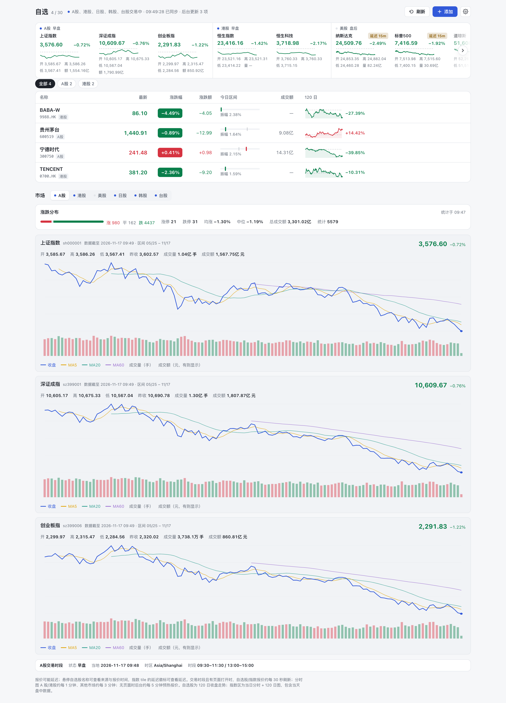

# stock-analysis-plugin

给 DeepSeek Harness (dsh) 用的股票研究插件，覆盖 **A 股、港股、美股、日股、韩股、台股**。在对话里直接查行情、做个股分析、全市场选股、策略回测和盘后复盘，并在 dsh Web / Desktop 侧栏查看仪表盘。



<sub>dsh Web / Desktop 中的「股票仪表盘」，真实行情截图。</sub>

## 能做什么

- **个股分析**：行情、技术面、财务、资金流、新闻与舆情汇总成研报，并标注缺失/过期数据。
- **全市场选股**：按 PE、PB、市值、趋势、股息等条件筛选，再由模型排序。
- **策略回测**：YAML 描述买卖条件，回测、诊断和验证稳健性。
- **盘后复盘**：指数、涨跌家数、板块轮动、涨停池、龙虎榜和情绪温度。
- **价值投资数据**：估值分位、股息、股东结构、ETF 折溢价、财报日历、公告、SEC 13F / Form 4。
- **持仓与风控**：组合集中度、压力测试、调仓计划和仓位计算。
- **dsh 仪表盘**：六市场自选股、指数分时、120 日图、成交量和交易时段，后台预热、打开即显示。

共 **76 个工具、21 个 Skills**，11 个数据源自动容灾；大部分功能不需要 API Key。

## 安装

需要本机有 **Python ≥ 3.10**。

```bash
dsh plugin --profile <profile> add dsh-stock-analysis
```

或使用 scoped 名：

```bash
dsh plugin --profile <profile> add @leev313217559/dsh-stock-analysis
```

dsh 用 pnpm 安装插件时默认不执行第三方安装脚本。如果 `.venv` 没有建起来，在 profile 的 `pnpm-workspace.yaml` 里给 `dsh-stock-analysis` 配置 `allowBuilds`，或进入插件目录手动运行：

```bash
node scripts/setup-python.mjs
```

详细安装、刷新节奏和数据路径见 [dsh 插件说明](dsh/README.md)。

## dsh 仪表盘

装好后，dsh Web / Desktop 侧栏会出现「股票仪表盘」：

- 自选股行情：最新价、涨跌幅、今日区间、成交额、120 日走势
- 顶部六市场指数：当日分时、最新价、最高/最低、成交额
- 地区顶部指数：独立 120 日图，含 MA5/MA20/MA60、成交量、OHLC 和悬停明细
- A 股涨跌分布：市场顶部单行展示
- 交易时段：一行显示状态、当地时间、时区和时段
- 打开即显示：后台预热，页面只读内存快照

## 配置

打开仪表盘右上角「设置」，编辑本机配置文件：

```text
$DSH_HOME/stock-analysis.env
```

默认 `DSH_HOME` 是 `~/.dsh`。每行一个 `KEY=VALUE`，保存后下一次工具调用生效，不需要重启 dsh。

数据目录：

```text
$DSH_HOME/stock-analysis/
├── watchlist.json
├── cache/
│   └── state/
├── signals.jsonl
└── reviews.jsonl
```

常用可选 key：

| 环境变量 | 用途 |
|---|---|
| `SEC_USER_AGENT` | SEC EDGAR 身份声明；13F / Form 4 / 美股公告需要 |
| `TAVILY_API_KEY` | Tavily 搜索 |
| `SEARXNG_BASE_URLS` | 自建 SearXNG 地址（逗号分隔） |
| `SENTIMENT_API_KEY` | 港美 Reddit / X / Polymarket 情绪 |
| `LIXINGER_TOKEN` | 理杏仁估值、港股财务与 DCF 输入 |
| `TUSHARE_TOKEN` | Tushare 行情备用源 |
| `LONGBRIDGE_*` / `FINNHUB_API_KEY` / `ALPHAVANTAGE_API_KEY` | 对应行情备用源 |
| `DATA_SOURCE_PROFILE` | `lean`（默认）或 `full` |

`tools/diagnostics.py check --market A` 会报告配置路径、权限和可用数据源，但不会打印密钥值。

## 工具与 Skills

- 行情：`get_quote`、`get_kline`、`get_market_indices`、`get_market_stats`
- 技术：`get_technical_analysis`、`detect_anomaly`、`analyze_pattern`
- 基本面：`get_financials`、`get_valuation_history`、`get_dividends`
- 公告与 SEC：`get_announcements`、`get_us_holdings`、`get_insider_trades`
- 选股与回测：`screen_stocks`、`run_backtest`、`validate_backtest`
- 组合：`analyze_portfolio_risk`、`plan_portfolio_rebalance`、`calculate_position_size`
- 无状态研究：`calculate_dcf_valuation`、`analyze_event_study`

完整清单见 [dsh 插件说明](dsh/README.md) 和 `tools/`。

Skills 在 `skills/*/SKILL.md`，覆盖缠论、波浪、龙头、情绪周期、趋势、放量突破等 21 套方法论。

## 开发

```bash
npm ci --ignore-scripts
npm run build:dsh
npx tsc --noEmit
.venv/bin/python -m pytest -q

npx tsx tests/test_dsh_dashboard.ts
npx tsx tests/test_dsh_discovery.ts
npx tsx tests/test_dsh_integration.ts
```

> 注：上面最后一行已不再适用；项目现在只保留 dsh 适配器。

测试和关键脚本：

```bash
npm run audit:keywords
npm run export:keywords
node scripts/setup-python.mjs
```

## 目录结构

```text
dsh/                 dsh 插件、仪表盘和页面
tools/               Python CLI 工具（共享核心）
skills/              21 套工作流/方法论 Skill
schemas/             报告 JSON Schema
templates/           报告模板
strategies/          回测策略示例
scripts/             dsh 构建、安装和校验脚本
tests/               Python 与 dsh 测试
docs/                数据源、回测 DSL、工具行为等文档
```

## License

MIT
