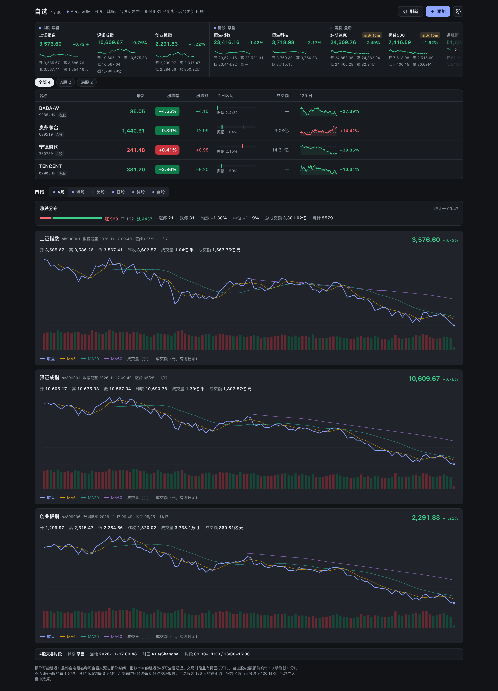

# Stock Analysis — DeepSeek Harness (dsh) Plugin

A 股 / 港股 / 美股 / 日股 / 韩股 / 台股的行情、技术分析、选股与回测。作为 dsh bundle 安装到 profile 后，对话中可调用 75 个工具，并自动注册 21 个工作流和策略方法论 Skill；dsh Web / Desktop 侧栏还会多出一个「股票仪表盘」。



## 安装

```bash
dsh plugin --profile <你的profile> add dsh-stock-analysis
dsh --profile <你的profile>
```

`dsh plugin add` 是 pnpm 的薄封装：安装后 dsh 会读取本包 `package.json` 里的 `dsh.bundle.patch`，把 `cordis.patch.yml` 作为一层叠加进 profile 组合。可用 `dsh --profile <你的profile> --dump-config` 验证 layer 已生效。

同一份插件也以 `@leev313217559/dsh-stock-analysis` 发布；装 scoped 版时，下文配置里的包名也换成 `@leev313217559/dsh-stock-analysis`。

从源码安装（本仓库根目录）：

```bash
npm install && npm run build:dsh
dsh plugin --profile <你的profile> add ./dsh
```

### Python 运行时

工具实际逻辑在 `tools/*.py`，依赖 `akshare`、`pandas`、`numpy`、`requests`。本包的 postinstall（`scripts/setup-python.mjs`）会在包目录下自动建 `.venv` 并装好依赖，前提：本机有 `python3 >= 3.10`。依赖安装失败时 postinstall 会返回非零状态，避免 pnpm 缓存未装完整的 `.venv`；解决安装问题后重新安装插件即可。

注意：dsh profile 使用 pnpm 且默认不执行第三方包的安装脚本。如 postinstall 被跳过，请在 profile 的 `pnpm-workspace.yaml` 中允许：

```yaml
allowBuilds:
  "dsh-stock-analysis": true
```

如果 venv 最终没建起来，plugin 会回退到系统 `python3`（Windows 为 `python`），此时请自行 `pip install -r tools/requirements.txt`。

## 股票仪表盘（Web / Desktop）

支持 dsh 前端的宿主会在侧栏显示「股票仪表盘」。首屏是自选股行情表：最新价、涨跌幅、涨跌额、今日区间（振幅与昨收位置）、成交额和 120 日走势（悬停可看每日收盘与较首日涨跌），可按列排序、按市场筛选。上方是六市场指数带，每个指数带当日分时线、最新价/涨跌幅、最高/最低和成交额（或成交量）；下方先显示 A 股独立的「涨跌分布」单行，再按地区展示顶部指数的 120 日走势与成交量，A 股为上证/深证成指/创业板三张独立图（一行一张），每张图含 MA5/MA20/MA60、OHLC、昨收、成交量和成交额（有则显示）与悬停明细，标题行同时显示数据截至时间和区间。A 股不再展示行业领涨/领跌模块。

指数数据：A 股/港股分时来自腾讯，通常接近实时；美股/日股/韩股/台股分时来自 yfinance 1 分钟线，通常延迟约 15 分钟，界面在指数 tile 右上角标注「延迟」，悬停可看具体延迟分钟数。120 日为日线，当天最后一根由分时数据合并，盘中即可看到未完成日线。成交量单位按市场标注（A 股为手，其他为股）；成交额只有部分市场/指数可得，缺失不伪造。

自选股按代码添加，支持逗号批量导入和删除，最多 30 只，覆盖六个市场。列表保存在 `$STOCK_WATCHLIST_FILE`，未配置时保存到 `$DSH_HOME/stock-analysis/watchlist.json`（`DSH_HOME` 默认为 `~/.dsh`）。文件损坏时拒绝静默覆盖。

右上角齿轮打开「凭证与配置」：直接编辑 `$DSH_HOME/stock-analysis.env`（凭证 + `DATA_SOURCE_PROFILE`），保存后下一次工具调用生效，不需要重启 DSH。格式错误会拒绝保存并给出行号；文件被外部修改时返回冲突，不会覆盖。

### 数据如何更新

数据由插件后台常驻预热：Web 路由注册后即开始按固定任务表调用现有 CLI（`stock_data.py quote/market_indices/kline/sector_rankings/market_stats` 与 `trading_calendar.py phase`），最多 4 个 Python 进程按优先级排队（报价 > 指数 > 走势 > 行业/统计），结果留在内存缓存。刷新节奏随各市场交易阶段变化：交易时段有页面打开时报价与指数约 30 秒、行业 1 分钟、全 A 统计 2 分钟；无人查看时放宽到 5–10 分钟；收盘后 30–60 分钟一次。失败保留上次成功值并标注，重试间隔按 1、2、4… 分钟退避。页面只轮询内存快照 `/api/snapshot`（有后台任务时 1.5 秒，否则 15 秒，页面不可见时停止），并在浏览器本地缓存 24 小时，打开即显示上次数据；「刷新」会让所有数据立即重新获取。不调用包含财务、新闻、风险等完整采集的 `run_watchlist_analysis`。前端接口只接受固定的快照、刷新和自选股操作，不开放任意 Python 脚本或参数。

前端由 `dsh/client.ts`、`dsh/dashboard.ts` 和 `dsh/web/`（`app.ts` + HTML/CSS）组成，均为 TypeScript，`npm run build:dsh` 将浏览器端编译为 IIFE 输出到 `dist/`；它不增加或改变 dsh 的 75 个模型工具。源码或 manifest 改动后重新运行 `npm run build:dsh` 并重装/重启对应 profile。

## 按需工具发现

dsh 0.2.2 及以上（工具注册支持按步骤的 `when` 条件）默认增加一个宿主控制入口 `stock_tool_search`；更早的 0.2.1 不提供该接口，插件会自动关闭按需发现并全量暴露工具，功能不受影响。按需发现只控制工具加载，不改变 75 个分析工具的名称、参数和输出。原生函数调用模式下，高频核心工具（`get_quote`、`get_kline`、`get_market_indices`、`get_market_stats`、`get_technical_analysis`、`get_news`）常驻，其余工具首次请求只暴露 `stock_tool_search`；其他插件的工具照常保留。搜索支持中文描述、英文关键词或确切工具名，例如 `财务`、`get_quote`、`run_backtest`；query 应把用户问题规范化为中文功能词，英文缩写/行话（PE、PB、ROE、MACD、13F、Form 4、ETF、PCF 等）保留英文，股票代码和工具名原样保留。命中工具在下一次模型请求提供完整 schema，再按原名调用。默认最多加载 5 项，`limit` 可设 1 到 20；无匹配返回空列表。

加载集合按 Agent 隔离，搜索和回退均保留宿主已有的工具权限限制。搜索入口被禁止或移除时，下一次请求保留原先已授权的完整股票工具目录。旧版缺少相关接口时保持全量暴露；PTC / both 模式沿用宿主生成的 SDK，不做发现过滤。加载集合在本次运行中保留，恢复会话或重载插件后需重新搜索。

如需关闭发现，在 profile 中本插件条目的配置中设置：

```yaml
- name: "dsh-stock-analysis"
  config:
    toolDiscovery: false
```

这里的 `stock_tool_search` 是 dsh 适配器的目录控制工具，只控制工具加载，不增加 Python 分析能力，也不执行分析。

调用顺序：核心工具已常驻；**其余工具必须先通过 `stock_tool_search` 加载**，未加载直接调用会返回 `unknown tool`。一次搜索可以命中多个工具（`limit` 最多 20），加载后在下一次模型请求按原名调用。

### 工具关键词元数据

搜索不是语义向量搜索，而是词面匹配；为了弥补同义词/口语词，每个工具定义里直接带 `keywords`：

```ts
pyTool({
  name: "get_capital_flow",
  description: "...",
  keywords: ["资金流", "主力资金", "超大单", "大单", "净流入", "capital flow"],
  parameters: {...},
})
```

- `pyTool` / `closedTool` 的 `keywords` 是必填字段，漏写会直接 TS 编译失败
- discovery 注册时收集每个工具的 keywords，拼进搜索文本并生成派生别名表（keyword → tools）；查询命中共享别名时优先提升，`财报` 这类词可以一次加载多个相关工具
- 关键词跟着工具定义走，不单独维护映射表；新增工具时在同一个 block 里补关键词即可
- 搜索测试覆盖 `资金流`、`龙虎榜`、`研报`、`财报`、`13F` 等典型词
- 审阅用生成清单：`docs/tool-keywords.md`（运行 `node scripts/export-tool-keywords.mjs` 刷新，勿手改）
- 覆盖标准：每个工具至少 8 个关键词，高频工具至少 12 个；`npm run audit:keywords` 检查
- 召回集：`tests/fixtures/tool-search-cases.json`，`test_dsh_discovery.ts` 逐条断言目标工具被加载
- 刷新清单：`npm run export:keywords`；审计：`npm run audit:keywords`
